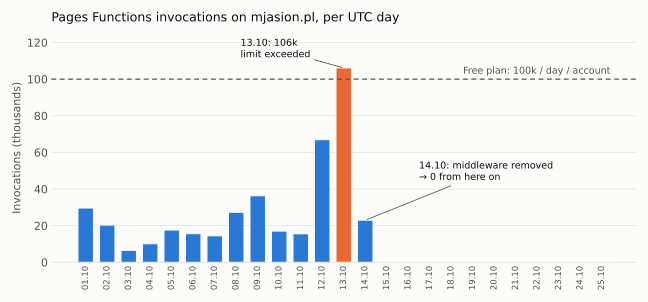
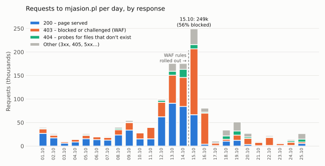

On 13 October my blog used up the whole daily Workers quota of my Cloudflare account. A static blog. No backend, no database, nothing that should ever need compute. This is the story of why it happened, who was hammering the site, and how the blog now serves markdown to AI agents without running a single Worker.

## The symptom: 100k invocations on a static site

The Workers free plan gives you 100,000 requests per day. The limit is **per account**, not per Worker. When you hit it, Cloudflare returns error 1027 until midnight UTC – for every Worker on the account. In my case that meant not only the blog, but also my private portal and the app my wife's students use for the natural-products course.

Pages Functions invocations on mjasion.pl, per UTC day:

| Day | Pages Functions | All other Workers |
|---|---|---|
| 07.10 | 14.5k | 1.3k |
| 08.10 | 27.3k | 1.4k |
| 09.10 | 36.3k | 1.9k |
| 10.10 | 17.1k | 3.9k |
| 11.10 | 15.6k | 1.5k |
| 12.10 | 66.9k | 1.5k |
| **13.10** | **106.1k** | 2.7k |



Everything else on the account together did under 3k a day. The blog alone did over 100k. And after 14 October the bars simply stop.

## The cause: `_middleware.ts` on every request

The blog is a static Astro site on Cloudflare Pages. Every page has a markdown twin (`/posts/foo/` → `/posts/foo.md`), plus `/index.md` and `/llms.txt`, so AI agents can read the content without parsing HTML. To make this work with content negotiation – send `Accept: text/markdown`, get markdown back from the normal URL – I had added `functions/_middleware.ts`.

A Pages middleware with no `_routes.json` runs **on every request**. HTML, CSS, images, favicon, the lot. Each one is a Worker invocation. On a quiet blog that is invisible. On a blog that someone decides to scan, it is a quota.

The fix went out on the morning of 14 October as a one-line commit message: *remove Pages middleware to stop exhausting Workers limit*. Invocations went from 5–6k per hour to 100 at 05:00 UTC and to zero from 06:00 UTC.

## Who was hitting the site

Last 7 days before the fix: 505k requests, **410k of them to `/`**. Cache hit rate: 0.2%.

**A scanning campaign from Google Cloud (AS396982)** – 75–90% of all traffic every day. Between 12 and 14 October alone, 181 GCP addresses sent 382k requests and pulled 8.4 GB. More on it in the next section.

**CERT Polska's Artemis.** On 13 October a single address, 195.164.49.70, made ~38k requests: crawled the site, tried Cloudflare's alternative ports (`:8080`, `:8443`, `:2083`…), enumerated subdomains and ran harmless SQL injection probes in the User-Agent. That was about 18% of the day's traffic – noticeable, but it started after the climb had already begun on 12 October. The main driver was GCP.

**Real crawlers** – Googlebot, Bingbot, GPTBot, ClaudeBot, Meta, Grok – were a few thousand requests each. Background noise.

## Anatomy of the campaign

### Timeline

| When | What happened |
|---|---|
| 1.10, 9.10 | Earlier, smaller waves (Netherlands and US, then Japan) – visible only in hindsight |
| 11.10 | 36k requests from 86 GCP addresses |
| 12.10, ~06:00 UTC | The real ramp-up: 97k requests from 96 addresses |
| 13.10 | 153k from 114 addresses – the blog's middleware crosses 100k invocations |
| 14.10 | Middleware removed; 132k from 108 addresses keep coming |
| 15.10 | Peak: 249k requests on the blog, first WAF rules start biting |
| 16–18.10 | Bot names rotate faster, a new "Android / Pixel 6" disguise appears |
| 19–20.10 | Moves to my other domains – ~118k requests in two days on a parked one |
| today | Still running, at a fraction of the volume, mostly bouncing off challenges |

The peak rate I measured was about 890 requests per minute from a single address. Another site owner reported over 3,000 per minute from one of the same IPs.

### Fresh cloud machines every day

The addresses came from the usual Google Cloud pools (`34.x`, `35.x`, later `136.8x–11x`), with `*.bc.googleusercontent.com` reverse DNS, spread over Tokyo, Singapore, Taiwan, Belgium, the Netherlands, Germany, the US East coast and Canada. Every request was answered by the Cloudflare data centre closest to that GCP region – Tokyo, Singapore and Taipei did most of the work.

The most telling detail: **the top address was different every day** (`35.221.115.223` on the 11th, `35.195.114.228` on the 12th, `34.87.51.216` on the 13th, `35.194.96.26` on the 14th). When I looked those addresses up on AbuseIPDB, their report history started on the very day they started scanning me – dozens of reports from dozens of different site owners, all "Web App Attack" and "Bad Web Bot", nothing older. Whoever runs this gets clean, reputation-free machines daily. Blocking IPs one by one is pointless; you have to match on behaviour or on the network.

### One client, thirty-four names

A single address, `34.87.51.216`, sent requests under **34 different User-Agents**, each about 800 times: GPTBot, ChatGPT-User, OAI-SearchBot, ClaudeBot, Claude-User, Googlebot, bingbot, PerplexityBot, Perplexity-User, DeepSeekBot, GrokBot, KimiBot, Meta, CCBot, Bytespider, Hunyuan, ChatGLM, YouBot, DuckAssistBot… plus thousands of plain `Chrome/153.0.0.0` on Windows. When the Chrome variant started getting challenged, a mobile `Pixel 6` variant showed up.

None of it was what it claimed to be:

- Real Googlebot and bingbot do not crawl from rented Google Cloud VMs in Singapore.
- The fakes **never fetched `robots.txt`** – the one file a real crawler asks for first.
- They **never loaded CSS, JS or images**. 96% of requests were `GET /` – the 33 KB homepage HTML, again and again.
- Cloudflare did not recognise any of them as a verified bot (`cf.client.bot` was false).

The most likely reason for the costume: checking whether a site lets "AI bots" through when it blocks everything else. A lot of sites now do.

### What it was looking for

Between the homepage hits – a few thousand probes on each domain:

- **Secrets:** `.env` in every variant (`.env.local`, `.env.production`, `.env.save`, `/backend/.env`, `/supabase/.env`, `/ai/.env`), `.git/config`, `.git-credentials`, `id_rsa`, `/private-key`;
- **cloud credentials:** `.aws/credentials`, `firebase-service-account.json`, `firebase-admin.json`, `google-services.json`, `gc-service.json`, `.azure/accessTokens.json`, `rclone.conf`, `.dbeaver/credentials-config.json`;
- **path traversal:** `/static/..;/..;/proc/self/environ`, `/assets../.env`, and a Vite source-map trick (`/__vite_rsc_findSourceMapURL?filename=…/.aws/credentials`);
- **exploits:** React2Shell (CVE-2025-55182) payloads against React Server Components, plus WordPress, Grafana and Apache probes;
- **panels and APIs:** `/sign-in`, `/dashboard`, `/billing`, `/settings/api-keys`, `/api/graphql`;
- **writes:** ~13k `POST` and ~3k `DELETE` on `/`, checking whether anything accepts them.

On a static site none of this exists, so it all ended as 404, 405 or – once the rules were in – 403. Nothing leaked. But the list is a good checklist of what *not* to have publicly reachable on anything you run.

### It went for everything

The blog was only where I noticed it, because that is where it cost something. The same campaign hit all ten of my domains on Cloudflare. Individual addresses went through them one after another – `34.58.72.210` hit the blog, the students' app and a parked domain within the same hour.

The worst-hit was a parked domain with no working site at all: ~118k requests in two days, 53k of them from a single `136.85.5.116`. It had a proxied wildcard DNS record (`*`), so every invented subdomain resolved – and the scanner happily enumerated `mail.`, `sentry.`, `portainer.`, `cpanel.`, `staging2.`, `wiki.`… One of them, `mail.`, got 13.5k requests in a day. Lesson: delete wildcard records you do not need; they turn your zone into an infinite target list.

It was not alone, either. Smaller, steady streams came from a Dutch hosting network (AS48090), Azure machines with an empty User-Agent, Alibaba Cloud and AWS – the usual background of the internet, made visible by the bigger fire.

### Who is behind it

I don't know, and Cloudflare's data cannot tell. These are someone's rented Google Cloud machines; only Google knows the customer.

What is public looks like an earlier wave of the same thing:

- **Mid-August 2026** – a Hacker News thread with 150+ upvotes: site owners noticing mass vulnerability scans from "ClaudeBot" and "Googlebot" that were neither.
- **28 August 2026 – GreyNoise** published the first proper analysis. Between 28 July and 23 August they saw 13 AI crawler names from eight companies being forged from 824 addresses spread over 795 different /24 networks – too scattered to block by network. All of it came from one HTTP client fingerprint (JA4H), which over 90 days wore more than 1,500 User-Agent strings, most of them ordinary browsers. The six forged AI names never asked for `robots.txt`, while the real ClaudeBot asked for it more than for any other path and never touched a credential file. None of the 824 addresses was inside the IP ranges the vendors publish. A nice detail: `Google-Extended` was forged in over 260k sessions – a token Google says no crawler ever sends. Targets: `.env` variants, `.aws/credentials`, `.git/config`, private keys, plus the Vite file-disclosure bug CVE-2025-30208. GreyNoise did not name an operator and only saw requests, not stolen files.
- **React2Shell (CVE-2025-55182)**, which showed up in my logs, is older and separate: a critical RCE in React Server Components, mass-exploited since December 2025 – for credential theft, cryptominers and Mirai, with AWS attributing some of it to China-linked groups. My scanner simply had it in the toolbox.

I could not find any public write-up of the October wave I saw. As far as I can tell this post is one.

Daily fresh projects in many regions fit two explanations: hijacked GCP accounts or leaked service-account keys, or accounts mass-created on stolen cards and free trials. The irony of a credential-hunting botnet possibly running on stolen credentials is not lost on me – but nobody has confirmed it.

What is clear: **I was not a target.** I was a row in a list of every reachable host. The payloads alone prove it: React2Shell exploits for React Server Components and WordPress probes for PHP, fired at a static Astro site that runs neither. Anyone who had looked at mjasion.pl even once would not have bothered. The timing with my post on X was a coincidence – the ramp-up started 14 hours before it.

### Telling a fake bot from a real one

- **Trust `cf.client.bot`, not the User-Agent.** Cloudflare verifies real crawlers by IP ranges and reverse DNS. Every rule I wrote has `not cf.client.bot` in it, so Googlebot and the real GPTBot pass and the costumes don't.
- **Never allow-list by User-Agent.** A rule like "let in anything that says `Claude-User`" lets in exactly this scanner – it was rotating those names. One day after I started thinking about such an exception, someone pretending to be ChatGPT-User was trying `/.env.production.local`.
- **Allow real agents by their published ranges.** Careful with ASN-wide rules: Anthropic's agents use `160.79.104.0/21`, which is announced *inside* Google's AS396982. My GCP challenge rule has an explicit exception for that range – without it, the real Claude would be challenged along with the fake ones.
- **Look at behaviour.** No `robots.txt`, no assets, hundreds of hits on `/` per minute, `POST` and `DELETE` on a static page – no human or honest crawler does that.

Further reading:

- [GreyNoise – Threat Actors Are Posing as OpenAI, Anthropic and DeepSeek to Target Credentials and Secrets](https://www.greynoise.io/blog/threat-actors-posing-as-ai-crawlers) (28.08.2026)
- [GBHackers – Fake OpenAI, Anthropic and DeepSeek Crawlers Target .env Files and Cloud Credentials](https://gbhackers.com/fake-openai-anthropic-and-deepseek/amp/)
- [PPC Land – Scanners posing as ClaudeBot hunt credential files from 824 addresses](https://ppc.land/scanners-posing-as-claudebot-hunt-credential-files-from-824-addresses/)
- [Enterprise DNA – mass vulnerability scans spoofing AI-crawler user-agents](https://enterprisedna.co/resources/ai-pulse/ai-pulse-2026-08-12-someone-is-running-mass-vulnerability-scans-while-spoofing-a/) (12.08.2026)
- [SecurityWeek – Exploitation of React2Shell surges](https://www.securityweek.com/exploitation-of-react2shell-surges/amp/) (08.12.2025)
- [Cloudflare – React2Shell threat brief](https://blog.cloudflare.com/react2shell-rsc-vulnerabilities-exploitation-threat-brief/)
- [AbuseIPDB – 34.87.51.216](https://www.abuseipdb.com/check/34.87.51.216)

## How markdown is served now: three URL Rewrite Rules

Content negotiation did not need a Worker in the first place. Cloudflare Transform Rules can rewrite the path based on a request header, and they run at the edge **before** the request reaches Pages. The markdown files are already static assets in the build, and Pages serves static assets for free and without limit.

Three rules in *Rules → Transform Rules → URL Rewrite*:

**1. Homepage**

```
http.request.uri.path eq "/"
and any(http.request.headers["accept"][*] contains "text/markdown")
```
Rewrite path to static `/index.md`.

**2. Pages without a trailing slash** (`/now` → `/now.md`)

```
not ends_with(http.request.uri.path, "/")
and not http.request.uri.path contains "."
and any(http.request.headers["accept"][*] contains "text/markdown")
```
Rewrite path, dynamic: `concat(http.request.uri.path, ".md")`

**3. Pages with a trailing slash** (`/posts/foo/` → `/posts/foo.md`)

```
ends_with(http.request.uri.path, "/")
and http.request.uri.path ne "/"
and not http.request.uri.path contains "."
and any(http.request.headers["accept"][*] contains "text/markdown")
```
Rewrite path, dynamic: `concat(substring(http.request.uri.path, 0, -1), ".md")`

The `not contains "."` condition keeps assets (`.js`, `.webp`, `.xml`) out of the rewrite. All three expressions work on the Free plan – no regex needed.

Try it:

```bash
curl -s -H 'Accept: text/markdown' https://mjasion.pl/ | head
curl -sI -H 'Accept: text/markdown' https://mjasion.pl/now/ | grep -i content-type
```

### Keeping the twins out of search results

Every page now exists twice, as HTML and as markdown. Search engines should only see the HTML, while agents should still be able to read the `.md`. `noindex` only affects search engines, so it does exactly that. In `static/_headers`:

```
# Markdown twins of every page – keep them out of search results.
# Accept: text/markdown requests are rewritten to the .md path at the edge
# before they reach Pages, so this rule covers negotiated responses too.
/*.md
  X-Robots-Tag: noindex

/cv.pdf
  Link: <https://mjasion.pl/cv/>; rel="canonical"
```

Because the rewrite happens before Pages, the header applies to both `/posts/foo.md` and `/posts/foo/` requested with `Accept: text/markdown`. And since the same URL now returns two different representations, `Vary: Accept` tells intermediate caches not to mix them up:

```
/*
  Vary: Accept, Accept-Encoding
```

Cloudflare's own cache is not affected – the rewrite changes the path before the cache lookup – but a corporate proxy might be.

## Stopping the scanner

Removing the middleware made the traffic free. It did not make it go away. On the Free plan you get five custom WAF rules and one rate-limiting rule per zone, which turned out to be enough:

1. **Sensitive paths – block.** `.env*`, `.git`, cloud credential files, traversal patterns. Nobody legitimate asks for these.
2. **Countries – block/challenge** for regions with no readers and lots of scanning.
3. **Unknown bots – managed challenge.** Anything with `bot`, `spider` or `crawler` in the User-Agent that is *not* a Cloudflare-verified bot (`not cf.client.bot`), limited to `/`. Real Googlebot and the real GPTBot pass; a GCP VM pretending to be GPTBot gets a challenge it cannot solve.
4. **Cloud scanner – managed challenge** for AS396982 on `/`, with carve-outs for Anthropic's IP range and MCP paths so my own connectors keep working.
5. **Rate limit** on `/`: 100 requests per 10 seconds per IP.

The `wildcard` operator is available on Free; `matches` (regex) is not. Limiting the bot rules to `/` was deliberate: the scanner hit the homepage 96% of the time, while legitimate agents read posts and `.md` files.

The share of scanner requests that got a 200 went from about 65% before any rules, to 20% after the first round, to under 2% after extending the bot rule. The scanner kept sending requests for days – it just bounced.



The busiest day was actually *after* the fix: 249k requests on 15 October, but 56% of them ended as a 403. Compare the blue part of the bars – pages actually served – before and after:

| | 13–14.10 | 21–25.10 |
|---|---|---|
| Requests per day | ~175k | 8–27k |
| 200 responses per day | 84–91k | 1–6k |
| Bandwidth per day | ~2.5 GB | 0.07–0.16 GB |
| Workers invocations from the blog | 106k / 23k | 0 |

## What I took away from it

- **Never run a Pages middleware without `_routes.json`.** If you need Functions, scope them to the paths that need them. If you can do it with a Transform Rule, do it with a Transform Rule.
- **The Workers limit is per account.** A runaway static site can take down unrelated apps.
- **Set Pages to *Fail open*** (Settings → Runtime). If Functions ever exceed the limit again, the site is served as static instead of throwing 1027.
- **Don't reach for "Cache Everything" on Pages.** Pages already serves assets from Cloudflare's CDN; a domain cache rule can serve stale deploys and, with header-based rewrites, the wrong representation.
- **A spoofed AI bot User-Agent is not an AI bot.** `cf.client.bot` is the only signal worth trusting on the Free plan.
- **Cloudflare won't punish you for being a target.** Exceeding Workers quota means errors until midnight UTC, not a suspended account. DDoS protection and WAF actions don't count towards any limit.

## What helped the most: Claude with the Cloudflare MCP server

I did not dig through this by hand. Almost the whole investigation ran in Claude, connected to my Cloudflare account through MCP, while I made the changes in the repo and the dashboard.

**The first connector was not enough.** I started with the *Cloudflare Developer Platform* connector. It sees Workers, KV, D1 and R2 – but no traffic analytics, no WAF, no DNS. The first diagnosis ("it's `_middleware.ts`, and it's mostly GCP") came from Claude clicking through the dashboard in my Chrome, with partially loaded charts and approximate hours.

**The full Cloudflare MCP server changed that.** It works in *code mode*: instead of hundreds of tools it exposes two – `search` over Cloudflare's OpenAPI spec, and `execute`, which runs a short JavaScript function against the whole API. One call can pull GraphQL analytics, the WAF rulesets and the DNS records together and return a ready summary. That is how it got:

- the per-day Pages Functions numbers from `pagesFunctionsInvocationsAdaptiveGroups`, which confirmed the diagnosis and showed the drop to zero;
- the scanner's fingerprint – ASN, the 181 IPs, the rotating User-Agents, the exact paths and methods, which data centre answered;
- the separation between the scanner, CERT's Artemis and real verified crawlers;
- the data for both charts in this post, pulled straight from the GraphQL API.

**It caught my mistakes.** This is the part I did not expect. Reading the live config back, it found:

- a WAF rule I thought I had saved but which still had the old expression;
- exceptions written as `index.xml` instead of `/index.xml`, which would never match;
- a header rule placed in the request phase, where `X-Robots-Tag` does nothing – it has to be a *Response Header* Transform Rule;
- the new rate limit blocking exactly one IP – me, testing the site in Development Mode;
- outside the blog: an abandoned Worker deployment from July whose crons failed eight times a day while sharing R2 buckets with production, a DNS edit of mine that broke a live site on another domain, and a "Server Error Report" alert screaming +1028% that turned out to be six real 5xx errors over a tiny denominator.

**Free plan gotchas it learned the hard way.** GraphQL Analytics on Free has a tight rate limit (roughly a 5-minute cooldown once exhausted), and a malformed query still burns the budget. `clientAsn` is not available as a dimension on Free. When GraphQL was throttled, the Workers Observability API (`/workers/observability/telemetry/query`) still worked, because it has its own limit.

Write access stays with me: every change it proposed – a rule, a DNS record, a redirect – it showed first and applied only after I confirmed.

## Regular check-ins

The single most useful habit was not a rule but a question I kept asking after every change: *how does the traffic look now?*

- **Minutes after a change.** Right after extending the bot rule, a 3.5-minute window already showed 96% of the scanner's requests ending in a 403. If a rule had broken something, I would have known before readers did.
- **A day later.** Checking 24 hours of data is what exposed the rate limit hitting a human, the rule that was never saved, and the campaign moving on from the blog to my other domains.
- **Across all zones, not just the one that hurt.** The same campaign showed up on all ten domains, peaking on a parked one that had no working origin at all.
- **A running state file.** After each check, the findings went into a note in a Claude Project: per-domain status, active rules, open to-dos, known quirks of the API. The next check started from that file instead of from zero – which also meant the to-do list ("add the trailing slashes", "decide what to do with the abandoned Worker") did not get lost between evenings.

The scanner is still knocking today. It just gets a challenge instead of my homepage – and I get a short report instead of a surprise.
